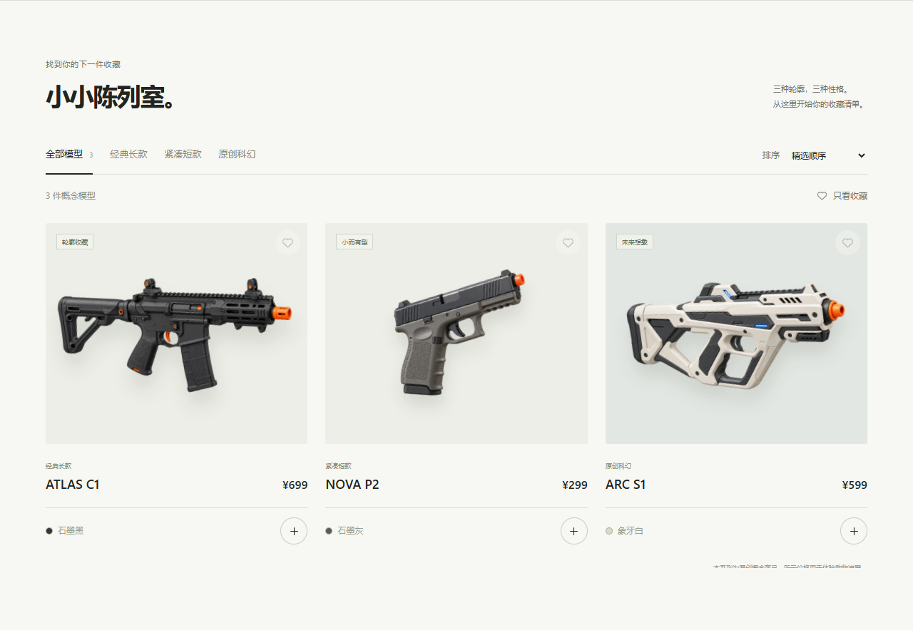

# Toy Storefront Demo · 玩具模型概念商店

一个无需构建、无需后端的中文独立站练习项目。用虚构的玩具模型商品演示浏览、筛选、收藏、购物车和本地订单，适合学习原生 HTML、CSS 与 JavaScript 的完整交互。

这不是营业中的商店：没有真实商品、支付、发货或个人信息收集。概念图片为 AI 生成，不代表实物规格。

## 界面预览



干净发布副本的实际浏览器截图；三个商品和价格均为虚构练习数据。截图展示真实页面，不是界面设计稿。

## 亮点

- 三类商品、关键词搜索、价格排序、收藏筛选与空状态。
- 商品详情弹窗、图片放大、数量限制和购物车合计。
- 收藏与购物车保存在当前浏览器，演示订单可预览、生成、回看并下载 JSON。
- 手机导航、原生对话框、键盘操作及减少动态效果偏好。
- 所有运行资源随仓库提供；没有运行时第三方 CDN、远程字体或 API。

## 前置条件

现代浏览器（需要原生 `dialog`、`localStorage` 和 Web Crypto 支持）。推荐 Python 3 启动本地静态服务器；自动化回归测试需要 Node.js 20+。

## 安装与运行

下载或克隆本仓库，在仓库目录运行：

```bash
python -m http.server 8000 --bind 127.0.0.1
```

浏览器打开 `http://127.0.0.1:8000`。无需 `npm install`。推荐 HTTP 预览，不以双击 HTML 的存储行为作为验证依据。

试用路径：选择商品 → 调整数量 → 加入购物车 → 预览订单 → 生成演示订单。整个流程不会向服务器提交交易。

## 目录结构

```text
index.html               页面、内联图标与对话框结构
style.css                桌面/窄屏样式和交互反馈
app.js                   商品数据、浏览、购物车、收藏与订单逻辑
assets/                  三张必要概念图片和 SVG 标识
tests/core.test.cjs       无依赖逻辑与资源回归检查
docs/images/catalog.png  实际运行的文档截图
README.md                使用和边界说明
```

## 修改商品

`app.js` 顶部的 `products` 数组集中定义名称、分类、价格与说明。添加商品时提供唯一 ID，并在 `assets/` 放入同名 PNG，同时调整首页静态分类数量、文案和测试预期。不要把不可信外部商品字段直接插入 HTML；当前渲染逻辑面向仓库内受控数据，不是通用电商 CMS。

## 验证方式

```bash
node --check app.js
node --test tests/core.test.cjs
```

测试涵盖数量边界、损坏存储输入、订单校验、价格合计、HTML 转义、本地资源与 PNG 元数据。它们不替代浏览器验收。

本次发布验证：7 项自动检查通过；在 Edge 的 1280×900 和 390×844 视口通过 25 项浏览器断言，包含收藏/订单刷新保留、购物车金额、实际 JSON 下载内容、键盘关闭和无横向溢出。未观察到 JavaScript 异常；窄屏视口测试不等于实体手机测试。

手动浏览器检查：

1. 搜索不存在的词，确认空状态；清除后恢复三个商品。
2. 收藏商品并刷新，检查收藏保留；按价格排序。
3. 两件 ATLAS C1 合计 1398，再加一件 NOVA P2 后为 1697。
4. 生成订单后购物车清空；刷新后回看上一份订单，检查 JSON 内容。
5. 使用 Escape 关闭弹窗；在 390 像素宽度检查菜单、详情和购物车。

## 数据与已知限制

- 仅保存当前浏览器同源的收藏、购物车和最后一份订单；不跨设备同步。清理浏览器数据会丢失记录。
- 禁用存储时仍可操作，但刷新后可能丢失；页面会给出提示。
- 订单按当前商品价格重新计算，不是不可变商业账本；没有库存、后台、身份认证或支付接入。
- 生成图只用于概念展示，不能证明实际尺寸、材料、结构或性能。
- 未验证实体手机、所有浏览器或真实商业环境。不要将此练习原型当作生产交易系统。

## 来源日期与许可证/所有权状态

原始作品创建于 **2026-10-07**，由 Codex 辅助独立编写页面和 SVG 标识。三张商品概念图在同一项目中通过图像生成创建，未复制第三方参考网站截图或商品图。

原图保留经检查的 C2PA 生成来源元数据；未发现本机路径、私人链接、账号或凭据。文档截图来自干净副本的虚构数据页面。

此仓库只保留独立运行必需内容，并补充中文说明、合成测试及实际运行截图；不含原任务对话、原始提示词、私人预览地址、托管身份配置或原 Git 历史。

源作品没有开源许可证，本仓库也没有擅自添加许可证。公开可见不等于授予任意再分发或商业使用授权。
